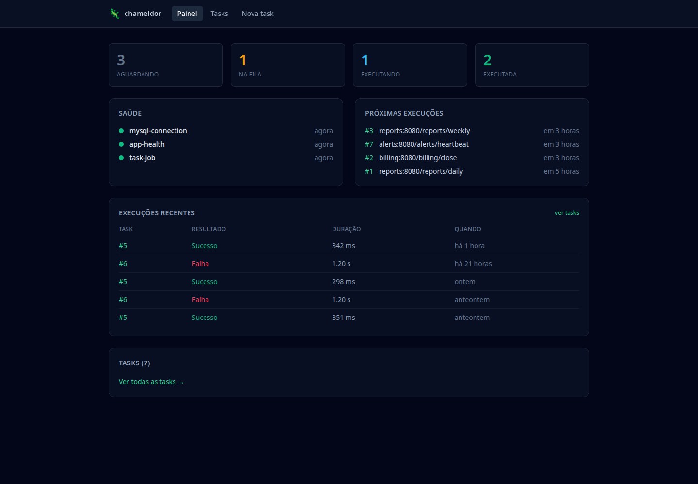

# chameidor

Monorepo for the self-hosted task scheduler/executor.



## Quickstart

Requires Docker, JDK 21 and Node.js 20+.

```bash
npm run setup
docker compose up --build
```

The SPA opens on `http://localhost:8101` and the API on `http://localhost:8100`; MySQL is on `localhost:8102`.

### Ports

Only the **host** side moves; container-internal ports stay fixed (`API_PORT=8080`, `WEB_PORT=8081`, MySQL `3306`). The committed [`.salgadinhos/ports.json`](.salgadinhos/ports.json) records the block, and a local env file may override any host port.

| Role | URL | Host env key | Container-internal |
|---|---|---|---|
| `api` | `http://localhost:8100` | `KTOR_PORT` | `8080` |
| `web` | `http://localhost:8101` | `WEB_HOST_PORT` | `8081` |
| `mysql` | `localhost:8102` | `MYSQL_PORT` | `3306` |
| `frontend-dev` | `http://localhost:8103` | `FRONTEND_DEV_PORT` | — |

## Checks

Each check on its own:

```bash
npm run be:unit
```

```bash
npm run be:detekt
```

```bash
npm run fe:typecheck
```

```bash
npm run fe:lint
```

```bash
npm run fe:test
```

```bash
npm run fe:build
```

The Docker-backed integration suite (Testcontainers MySQL) is separate:

```bash
npm run be:integration
```

The canonical all-checks command mirrors the pre-commit hooks:

```bash
npm run precommit
```

## How it fits

chameidor is the family's shared task scheduler: other apps register one-time and cron tasks over HTTP and receive a callback when they are due. The seam that matters across repos is the wire contract — the edge DTOs, mirrored by hand in the SPA and published as fixtures in [`contracts/`](contracts/README.md). See the [code map](docs/code-map.md) for the module and entry-point map.

## Limits

- The GitHub social preview — a crop of `docs/assets/dashboard.png` — is a manual Settings-page upload by the repo owner.
- The SPA ships dark-only, so the primary screenshot is dark; there is no light-theme capture.
- Deploying the combined image against a real MySQL and token is a host step the Quickstart cannot perform: [Deploying the combined image](docs/runbooks/deploy.md).
- Registering a new consumer's bearer token is an out-of-band registry step: [External systems registry](backend/docs/external-systems.md).
- Task registration and detail screens are not built — `/tasks/new` and `/tasks/:id` are placeholders.

## Docs

- [Repository conventions](AGENTS.md) — open it when you need the cross-cutting rules every session must know.
- [Domain glossary](CONTEXT.md) — open it when a domain term needs a precise meaning.
- [Code map](docs/code-map.md) — open it to go from a module or seam to the files that matter.
- [Backend conventions](backend/AGENTS.md) — open it before touching `backend/`.
- [Frontend conventions](frontend/AGENTS.md) — open it before touching `frontend/`.
- [Coding standards — Kotlin lane](backend/CODING_STANDARDS.md) — open it for the Kotlin idiom rules the tooling does not enforce.
- [Coding standards — React lane](frontend/CODING_STANDARDS.md) — open it for the TypeScript and React idiom rules the tooling does not enforce.
- [Wire contracts](contracts/README.md) — open it for the request and response shapes consumers integrate against.
- [External systems registry](backend/docs/external-systems.md) — open it to register, rotate or deactivate a consumer token.
- [Observability — logging & metrics](backend/docs/observability.md) — open it when a change emits or configures telemetry.
- [Deploying the combined image](docs/runbooks/deploy.md) — open it to run the published image against a real database.

## Related projects

- [portfolio-2](https://github.com/luiznaac/portfolio-2) — an investment tracker that schedules its own jobs through chameidor.
- [shougong](https://github.com/luiznaac/shougong) — a sibling monorepo with the same backend plus SPA shape and combined image.
- [environments](https://github.com/luiznaac/environments) — the kotlin scaffold this backend derives from.
